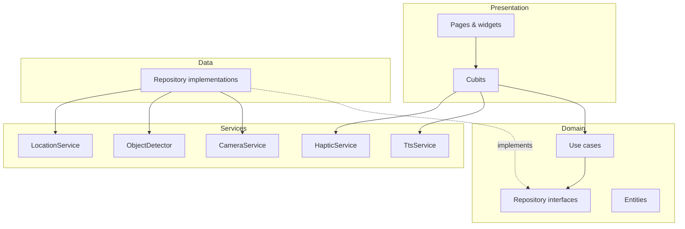
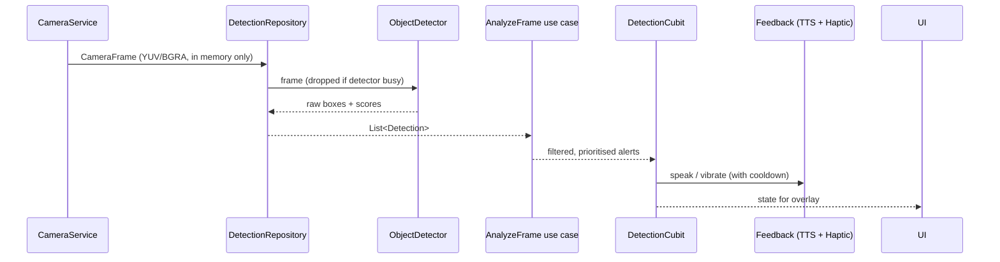

# Glide — Architecture

## Key decisions

| Decision | Choice | Why |
|---|---|---|
| State management | **flutter_bloc (Cubit)** | The spec asks for BLoC/Cubit in the presentation layer. Using one state library avoids mixing Riverpod and BLoC. Cubits are plain classes, easy to unit test with `bloc_test`. |
| Dependency injection | **get_it**, registered by hand in `lib/core/di/injection.dart` | No code generation step to forget; every registration is visible in one file. Can move to `injectable` later without touching features. |
| Routing | **go_router** | Declarative, official, supports deep links (needed later for QR venue links). |
| On-device detection | **tflite_flutter** + quantized SSD MobileNet / YOLO model in `assets/models/` | Cross-platform, runs offline. Model choice is made in Milestone 2. |
| Text recognition | **google_mlkit_text_recognition** | On-device, fast, free. Latin script at launch; Chinese recogniser added with zh locales. |
| Speech | **flutter_tts** (platform TTS engines) | Offline voices on both platforms, many languages. |
| Haptics | **vibration** | Supports patterns and amplitude, which `HapticFeedback` does not. |
| Location | **geolocator** | Position stream, bearing and distance helpers. |
| Local storage | **shared_preferences** for settings, **hive_ce** for cached data, **flutter_secure_storage** for anything sensitive | Simple, all offline. |

### Platform minimums

- Android: minSdk 26, targetSdk 34+.
- iOS: **15.5**, not 13.0. Current Google ML Kit pods require iOS 15.5. Devices that cannot
  run iOS 15.5 (iPhone 6 and older) are a very small share of users.

## Layers



Rules (enforced in review, see CONTRIBUTING.md):

1. `domain/` imports only Dart, `equatable`, and other `domain/` code. No Flutter, no plugins.
2. `presentation/` never imports `data/`. It gets use cases and services from get_it through constructors.
3. `services/` wrap one platform plugin each behind an abstract class, so tests use fakes.
4. Only `lib/core/di/injection.dart` knows which concrete class implements an interface.

## Folder structure

```
lib/
├── main.dart                 # bootstrap: DI, then runApp
├── app.dart                  # MaterialApp.router, themes, l10n
├── core/
│   ├── constants/            # app-wide constants
│   ├── di/                   # get_it registration
│   ├── error/                # Failure types
│   ├── geo/                  # GeoPoint, distance, bearing (pure Dart)
│   ├── router/               # go_router config
│   ├── themes/               # light, dark, high-contrast
│   ├── utils/
│   └── widgets/              # accessible building blocks
├── features/
│   ├── detection/            # obstacles + crossing (domain/data/presentation)
│   ├── camera/               # permission + lifecycle shared by camera screens
│   ├── navigation/           # saved places + compass guidance back to them
│   ├── text_reader/          # OCR + read aloud
│   ├── settings/             # user preferences
│   └── authentication/       # placeholder for future cloud features
├── services/
│   ├── ai/                   # ObjectDetector (TFLite), TextRecognizer (ML Kit)
│   ├── camera/
│   ├── tts/
│   ├── haptic/
│   └── location/
└── l10n/                     # ARB files
```

## Detection data flow



Frames are processed on a background isolate from Milestone 2. A frame arriving while
the previous one is still being processed is dropped, which keeps latency bounded and
saves battery.

## Distance estimation

MVP: estimate from bounding-box height and a per-class typical height
(`distance ≈ realHeight × focalLength / boxHeightPixels`), reported as a band, not a
precise number. Phase 2: fuse LiDAR depth on supported iPhones via a platform channel.

## External APIs

None in the MVP. Everything runs on the device. Milestone 4 guides to places the
user saved, with GPS and the compass only. Street routing, address search and
"where am I" need a routing or geocoding provider; choosing one (and updating the
privacy policy) comes before any code that calls it. Cloud features
(Firestore sync, community maps) are Phase 2+ and will get their own API contract here.

## Security and privacy

- Camera frames live only in memory and are released after inference.
- Location is used only while the navigation screen is open and is not persisted,
  except places the user explicitly saves, which go in `flutter_secure_storage`.
- Anything sensitive stored locally goes through `flutter_secure_storage`.
- Settings → "Delete my data" clears shared preferences, Hive boxes and secure storage.
- No analytics or network calls in the MVP; the privacy policy must be updated before any are added.
- Android `INTERNET` permission is declared for future features and map tiles only.
